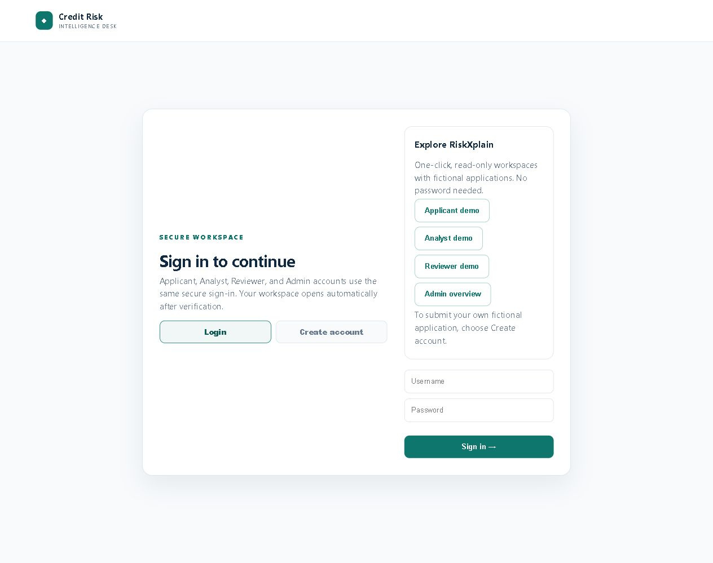
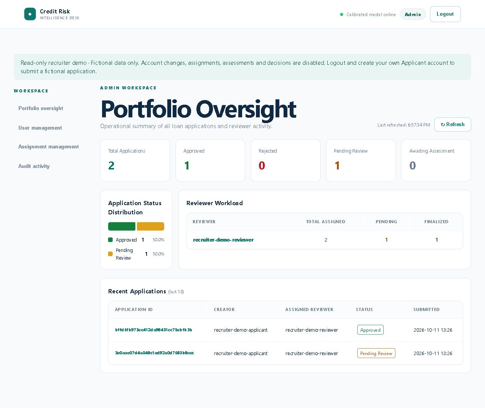
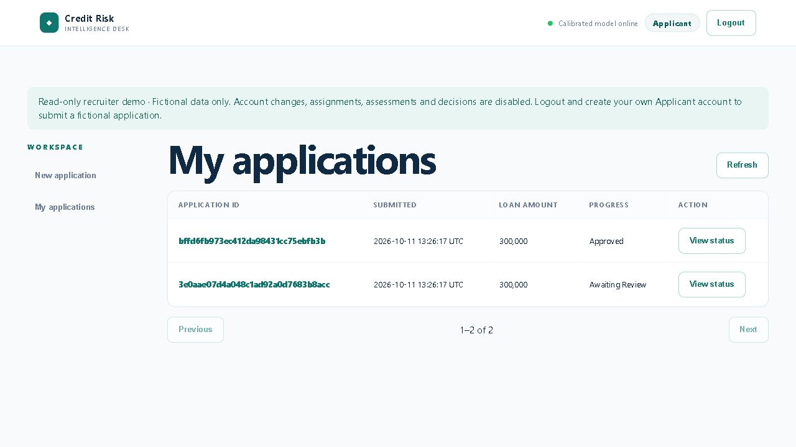
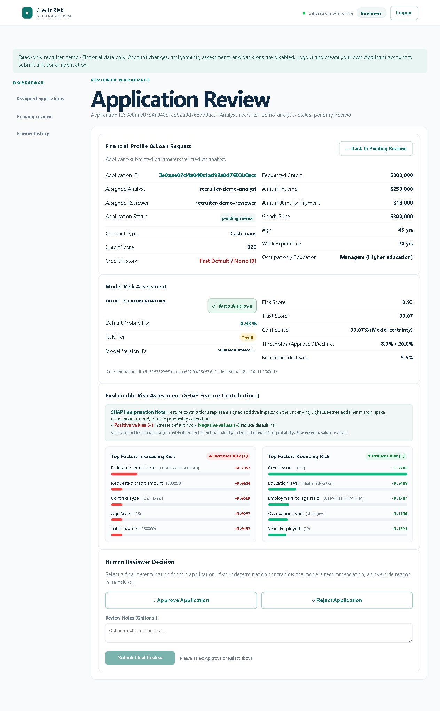

# RiskXplain

A student portfolio project demonstrating explainable loan applications across **Applicant, Analyst, Reviewer and Admin** workspaces. Fictional data only; this is not a lending service.

**Public URL:** will be added after the approved Render release is deployed and verified.

## Recruiter demo

Open the login page and choose **Applicant demo**, **Analyst demo**, **Reviewer demo**, or **Admin overview**. No password is needed. Logout to switch workspaces.

- Applicant: inspect Approved and Awaiting Review application statuses.
- Analyst: open a stored application and inspect its financial snapshot and assessment.
- Reviewer: open the pending application for model recommendation and signed SHAP explanations; inspect Review history.
- Admin: inspect portfolio counts, assignments, user directory and sanitized audits.

The two fictional examples are **read-only**, enforced by the backend. Demo sessions cannot submit applications, run assessments, review, reassign or change account access. Random demo passwords are never published. Real Admin credentials stay private. To try submission, logout and create your own Applicant account using fictional inputs; a private Analyst/Reviewer processes it.






## Technology stack

| Layer | Technology |
|---|---|
| API | Python 3.11, FastAPI, Pydantic |
| Frontend | Vanilla HTML, CSS and JavaScript ES modules |
| ML | LightGBM with scikit-learn probability calibration |
| Explanations | SHAP TreeExplainer on the underlying tree model margin |
| Authentication | JWT, scrypt, database-backed roles and session versions |
| Database | PostgreSQL on Neon; SQLite locally |
| Hosting | One Docker/FastAPI service on Render Free |

Model logic/artifacts are unchanged. scikit-learn 1.9.1 matches the calibrated artifact. All 30 bundled examples produced exactly identical serialized predictions and SHAP results compared with the previous environment, without estimator-version warnings. Runtime dependencies are pinned in `requirements.txt`.

## Four-role workflow

1. Applicant registers and submits 13 fields. Submission performs no inference.
2. Analyst claims, assigns a Reviewer and assesses the application.
3. Prediction and SHAP are persisted. Reviewer approves/rejects; overrides require a reason.
4. Applicant sees the final status, without staff notes, predictions, SHAP or audit data.
5. Private Admin manages accounts/assignments and reads operational history.

Lists are paginated. Database role, activation and session-version checks remain authoritative. Final decisions cannot be reopened through reassessment. Demo startup loads two precomputed examples without inference; repeated initialization does not duplicate them.

## Run locally

```powershell
python -m venv .venv
.venv\Scripts\Activate.ps1
pip install -r requirements-dev.txt
$env:DEMO_ENABLED = 'true'
python -m uvicorn Backend.main:app --host 127.0.0.1 --port 8000 --workers 1
```

Open `http://localhost:8000`. Local mode uses SQLite. Public registration creates Applicants only. Development passwords must never be used on the public deployment.

```powershell
# Tests: disposable data only, never production Neon.
$env:DATABASE_URL = ''
$env:DEMO_ENABLED = 'false'
$env:CREDIT_DATASET_DB = "$env:TEMP\riskxplain-tests.sqlite3"
python -m pytest -q
node --experimental-vm-modules scripts/check_phase3b.cjs
node --experimental-vm-modules scripts/check_phase3c2.cjs
node --experimental-vm-modules scripts/check_phase4.cjs
```

Optional integration tests use `CREDIT_PHASE4_TEST_DATABASE_URL` and `CREDIT_TEST_DATABASE_URL`, pointing only to a disposable localhost PostgreSQL server. They create temporary schemas.

## Simple deployment

The existing GitHub destination is `https://github.com/Varun-kumar0211/Home-Credit-Default-Risk`. **Commit/push, resource creation and deployment require the owner's approval.** No new release has been deployed during preparation.

1. After approval, commit/push the complete release, including currently untracked frontend modules, demo code/JSON and screenshots. Do not stage secrets or local databases.
2. Create a **Neon Free** project for fictional data, near the Render region. Copy its PostgreSQL URL with `sslmode=require`, retaining Neon's recommended parameters. Do not import a local user database or real financial records.
3. Create one **Render Free Web Service**, connected to the repository, root directory, **Docker** runtime, existing `Dockerfile`, no Docker command override, health path `/health`. Alternatively use `render.yaml` after approval. Keep one worker; no extra service or persistent disk.
4. Set environment variables privately in Render:

| Variable | Value |
|---|---|
| `APP_ENV` | `production` |
| `DATABASE_URL` | Neon PostgreSQL SSL URL |
| `CREDIT_JWT_SECRET` | Long random private secret |
| `CREDIT_AUTH_USERNAME` | Private bootstrap Analyst username |
| `CREDIT_AUTH_PASSWORD` | Strong private bootstrap password |
| `DEMO_ENABLED` | `true` |
| `WEB_CONCURRENCY` | `1` |

Render supplies `PORT`; the entrypoint binds `0.0.0.0:$PORT`. Production refuses missing secrets/DB URL and filesystem-only persistence. PostgreSQL tables initialize automatically. Connections are fresh per operation, commit/rollback and close on context exit; subsequent operations reconnect after socket loss. No pool or background job is required.

5. After separate deployment approval, deploy and inspect build/startup logs. Verify HTTPS login, `/health` with `model: calibrated`, all four demo buttons and persistence after restart. Add the verified public URL above.
6. Keep private staff accounts separate. Bootstrap creates an **Analyst**, not an Admin. The demo already supports read-only exploration of all four workspaces. To process new applications, provision private Reviewer/Admin accounts once using the existing repository helpers and prompted passwords. Never publish unrestricted staff credentials or use the development-only seed script against Neon.

One-time operator provisioning, only after approval, with the intended demo PostgreSQL URL and required production settings loaded privately in the local environment:

```python
# Run interactively from the repository root with requirements installed.
import sys
sys.path.insert(0, 'Backend')
from getpass import getpass
from Backend.auth import hash_password
from Backend.config import DATABASE_URL, DATASET_DB_PATH
from Backend.repository import DatasetRepository
assert DATABASE_URL, 'Set the intended demonstration PostgreSQL URL privately'
repo = DatasetRepository(DATASET_DB_PATH, database_url=DATABASE_URL)
assert repo.create_user('portfolio-reviewer', hash_password(getpass('Private Reviewer password: ')), 'reviewer')
assert repo.create_user('portfolio-admin', hash_password(getpass('Private Admin password: ')), 'admin')
```

Existing usernames are preserved. If creation fails, inspect the account rather than overwriting its credentials.

## Free-tier limits and troubleshooting

- Free Render services sleep after inactivity. Allow startup time and refresh once. There is no background polling.
- CSV analysis accepts **50 rows / 1 MiB**; JSON batches accept 50 applications. Use the bundled 30-row dataset. One worker, numerical thread limits and an eight-request server concurrency cap bound simultaneous work. Excess requests receive HTTP 503; retry after a moment.
- **Missing settings:** supply all required variables in Render; do not put secrets in Git or Docker build arguments.
- **DB connection failure:** check Neon URL, SSL and credentials; a later request opens a fresh connection. Do not blindly replay a write with an unknown outcome. `/health` does not probe the database.
- **Demo unavailable:** check `DEMO_ENABLED=true`, startup logs, reserved account roles, and inclusion of the calibrated artifact plus `Data/recruiter_demo.json`.
- **Read-only action error:** intentional for demo sessions. Use your own Applicant or private staff account for changes.
- **Invalid staff login:** registration cannot create staff. Changing bootstrap environment variables does not reset an existing DB password.
- **Model version warning:** use pinned requirements and the verified artifact; do not suppress warnings or replace/retrain the model.
- **Windows Docker startup script failure:** shell scripts use LF via `.gitattributes`. Entrypoint runs from `/app` so serialized Backend classes import correctly.
- All persistent data belongs in Neon, not Render's filesystem. Git/build exclusions cover environment secrets, private keys, SQLite files and sidecars. Use fictional records only and periodically inspect demo database storage usage.

See `DEPLOYMENT_PREPARATION_REPORT.md` for verification results and remaining limitations. Local Windows memory measurements are not a guarantee of Render Linux memory usage. No paid services, frontend framework, queue, background worker or document-upload storage is needed.
